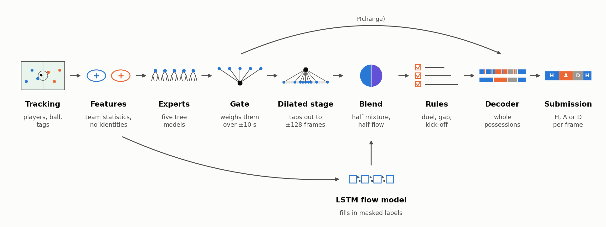
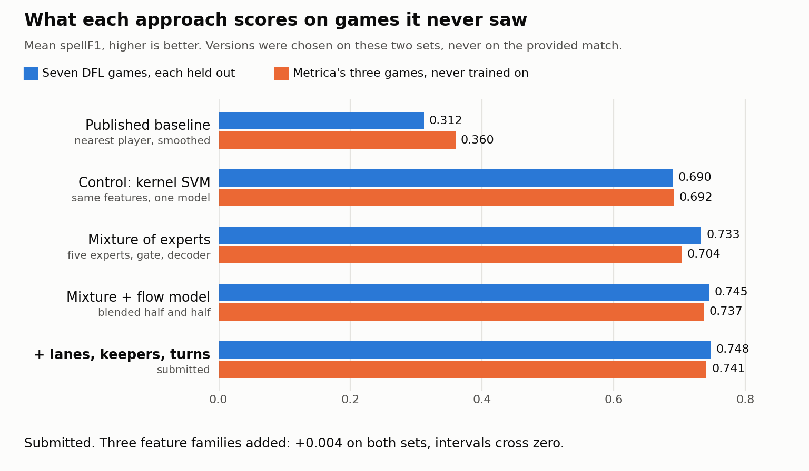
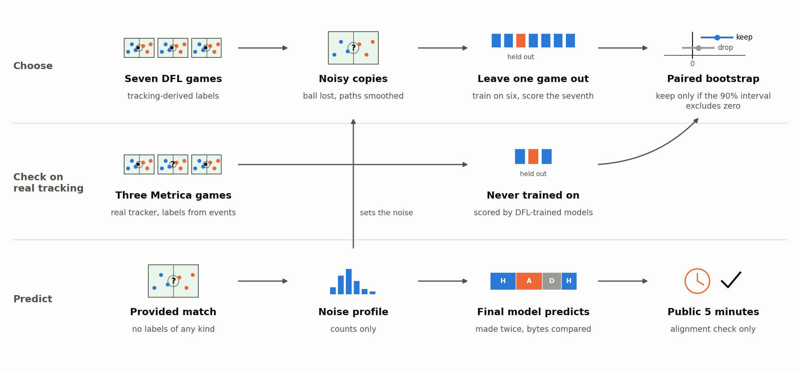
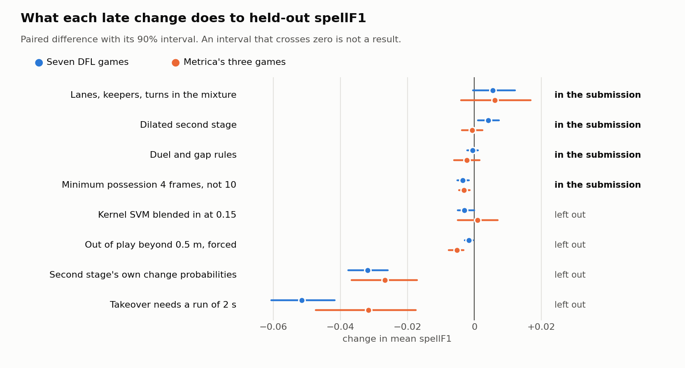
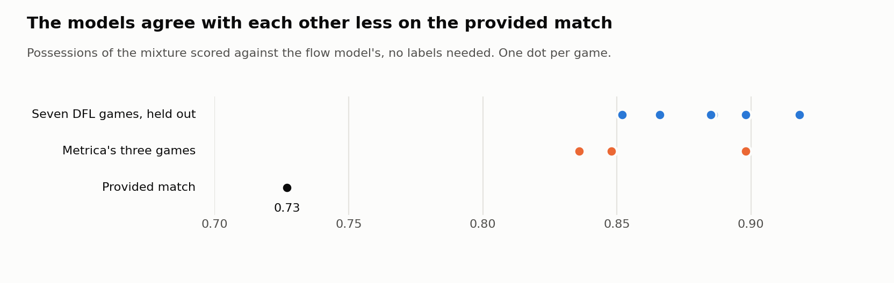

# Possession from tracking: a mixture of experts

**Team:** Blundell · **Members:** Ethan Rajkumar, Vivaan Jhaveri, Nathan Rajkumar, Will Gervasio  
More Than A Hack 2027, Phase 1 · Barcelona vs Athletic Club

---

## 1. Approach

### The problem, as we read it

Three facts shaped every decision.

1. **spellF1 scores whole possessions.** Each possession counts once, and a predicted one only
   scores if it overlaps a true one closely. A model can label 94% of frames correctly and still
   score poorly if it splits long possessions or misses short ones. So the output has to be
   clean, whole possessions, not frame-by-frame guesses.
2. **The ball is missing on 41% of graded frames** (CHALLENGE.md; we measured 40.7% on the
   provided tactical tracking). A method that needs to see the ball fails on those frames.
3. **The ground truth comes from corrected tracking, not from events.** So the best training labels are tracking-derived too.

### What we built



**1. Features.** Several hundred numbers per frame, all computed over a team's visible players and
never over a single track, because tracks are fragments, not people. Team shape (centre, spread,
height of each line), speeds, players near the ball, the ball's speed and how sharply it changes,
distance to the lines, and how long since the ball was last seen. Each is taken raw and averaged
over 0.2, 1 and 3 s, with before-versus-after contrasts that mark the moment something changes.

**2. Five experts.** Each is a gradient-boosted tree model, which handles missing values without
filling them in. Each sees only part of the evidence or answers a narrower question:

| Expert | Sees | Predicts |
|---|---|---|
| Ball | ball-related features only | H, A or dead ball |
| Shape | team shape and movement only, **never the ball** | H, A or dead ball, so it keeps working when the ball is lost |
| Dead ball | everything | ball in play or not |
| Transition | the frame and the half-second around it | a change to H, A or dead ball within 3 frames |
| Touch | the frame and the half-second around it | a player of H or A touches the ball within 3 frames |

The touch expert learns what a touch looks like in the players' movement as well as in the
ball's, because it is trained on copies where the ball is hidden.

**3. Gate.** A second-level model reads all five experts' outputs at each frame, shifted up to
2 s either way and averaged over windows of up to 10 s, together with context such as whether the
ball is seen and for how long it has been lost. It learns how far to trust each expert in each
situation. It is trained only on predictions the experts made for games they never saw, so it
cannot learn to trust an expert that has merely memorised its training games. This was the
largest single gain of the project (+0.046 spellF1).

**3b. Dilated second stage.** A temporal convolutional network sees far in time through dilated
taps. We give trees the same view: a second tree model reads the gate's output at 0, ±1, ±2, ±4,
up to ±128 frames (about 5 s either way) and gives P(H/A/D) again. It is trained only on gate
output for games the gate never saw. It gains +0.004 on the DFL games and nothing on Metrica's
(section 5).

**4. Flow model.** A second, different model: a bidirectional LSTM trained by flow matching to
fill in masked possession labels from the same features over 60-second windows. Its first-step
probabilities are blended half and half with the gate's (+0.019 on the DFL test games, +0.020 on
Metrica's).

**5. Decoder.** Turns per-frame probabilities into whole possessions. It finds the most likely
sequence of possessions under three rules: each possession lasts at least 4 frames, each
stoppage at least 10, and every change of possession has a cost. Its settings are searched for the
best spellF1 on held-out games, except the 4 frames. That is our reading of the definition: a
brief H A H is one long possession of H, and anything of 4 frames or more may stand on its own.
It is a choice, not a measured gain: against 10 frames it costs 0.004 on the DFL games and 0.003
on Metrica's. The table in section 5 compares the approaches at 10 frames; the submitted model,
with its second stage and rules, reads 0.752 and 0.737 at 4.

**Smart Tagging** joins as a sixth expert only if the provided match's tags agree with its own
tracking at least as well as realistic simulated tags do. They passed, after the check found and
corrected a 2.6 s delay.

The broadcast tracking is not used in the submitted model (section 2).

### Training data: clean games made to look like ours

We train on the seven open DFL Bundesliga games, whose labels come from the league's own
tracking: whether the ball is in play and which team owns it, on every frame. That is the same kind of source as the challenge's ground truth.

The DFL tracking is cleaner than the provided match's: in all seven games the ball is seen on
every frame in play. So each game becomes many noisy copies that lose the ball and players the way the provided tracking does — in crowds, through stoppages, in fast passes — with the ball's path smoothed and drifting like the provided one. The rates come from measuring the provided match's tracking, without any labels (`profile` and `diagnose`). The model never sees the clean version at prediction time: it learns to read possession through the noise.

Every model is trained with the teams in both orders, so it cannot learn that "home has the ball more".

### Why this design and not another

- **Nearest player plus smoothing** (the organisers' baseline) scores 0.243 on the full match. It
  flickers or blurs, and it has nothing to go on when the ball is lost.
- **Experts rather than one model:** an expert that never sees the ball does not fail when the
  ball is lost, and the gate learns when to switch between them.
- **A decoder rather than smoothing:** smoothing blurs every edge by its window. The decoder keeps
  edges sharp and enforces realistic possession lengths.
- **Not the video or the homography:** even a perfect ball on every frame was worth at most +0.07
  in our tests. The larger gap is short possessions after turnovers, where the evidence is weak.

### Result in one line

Each game scored by a model that never saw it, at the submitted settings: **spellF1 0.752** on
the seven DFL games and **0.737** on Metrica's three sample games, real tracking from the
provider of the challenge's data. The published floor on the provided match is 0.243.

---

## 2. Assets used and dropped

| Asset | Used | How, or why not |
|---|---|---|
| Tactical tracking (ATD) | Yes | The only positional input at prediction. Also measured without labels (`profile`, `diagnose`) to set how the training copies lose and smooth the ball and players. |
| Smart Tagging | Yes, behind a check | Read as features and as a sixth expert only because its open-play tags agree with the match's own tracking as well as simulated tags do. Set pieces are read for their timing, not their team: only 33 of the 59 name a team, too few to judge. |
| Broadcast tracking | Tried, dropped | We filled the ball's gaps from the broadcast and trained a model on copies made to match. Its mixture was level with the tactical one on held-out games (0.731 against 0.733 on DFL), and its flow model's held-out run did not finish in time, so it is not submitted. |
| Video and homography | No | Copying the true label into every frame where the ball is lost is worth at most +0.07, so even a perfect ball from the video is not where the points are. |
| Public five-minute ground truth | Check only | To confirm the file is aligned and well-formed. Never used to choose between versions or to tune anything. |
| Kernel SVM | Control only | Section 5. Blending it in lowered the score, so it is not in the submission. |

## 3. Training data

None of it comes from the provided game.

| Dataset | Source and licence | Who labelled it | Amount | Role |
|---|---|---|---|---|
| Seven DFL Bundesliga matches | Bassek et al., *Scientific Data* 2025, CC BY 4.0 | The league's tracking: a per-frame ball status and possessing team. Mechanical, not hand labels by us. | About 1.0 million frames in play, 3,061 possessions | Trains every model. Each game is also held out in turn for validation. |
| Three Metrica sample games | github.com/metrica-sports/sample-data (no licence stated; the source asks to be acknowledged) | Metrica's own automatic tracking, with human event data. We build per-frame labels from the events by one fixed rule: a team owns the ball from its on-ball event until the other team's next one, and the ball is dead from a ball out, foul, goal or offside until the restart. | About 430,000 frames in play, 1,141 possessions | Validation only. The submitted model does not train on them. |

The provided match is read without labels for two things only: aggregate noise statistics
(how often and for how long the ball and players are lost, how smooth the paths are), and the
Smart Tagging check. Training copies of the DFL games are then corrupted to those statistics.

## 4. Possession rules implemented

The model learns the rule from the DFL labels; it is not hand-coded. What that amounts to:

- **Three states.** Every graded frame is H, A or D. Frames outside the published half blocks
  are X.
- **Who has it.** The team the tracking data names as owning the ball while it is in play.
  There is no contested state: a loose ball stays with the team that last had it until the
  other team's possession begins.
- **Challenges and deflections.** A touch by the other team becomes a possession only if it
  lasts at least 4 frames. A brief H A H therefore stays one possession of H. We tried a
  stronger rule, giving any interruption under a second back to the interrupted team, and
  dropped it: it lost 0.017 on DFL and 0.011 on Metrica, whose labels count such touches.
- **Dead ball and restarts.** The ball is dead from the moment the DFL labels mark it out of
  play until the restart. A stoppage lasts at least 10 frames. Frames of a period before its
  kick-off are held dead; the kick-off is found from the tracking alone.
- **Where a change falls.** At the frame where the evidence for a change peaks. The training
  target accepts a change within 3 frames, which is where spellF1 starts to charge for lateness.
- **Ball not seen.** Possession carries through the gap on the players' shape and movement.

### The rules we set out, and what the submitted model does with each

We wrote the definition down as explicit rules first. The submitted model is learned, so some of
them are enforced by the decoder, some are learned from the DFL labels, and some are not enforced
at all. The table says which.

| Rule as we set it out | What the submitted model does |
|---|---|
| A touch, deflection, block or lost duel is not a change of possession. | Enforced only below 4 frames, by the minimum possession. A longer touch follows the DFL labels, which give it a possession of its own. |
| A takeover needs a run of at least 2 s and enough evidence for the decoder. | The evidence part is enforced: the decoder changes team only when the change evidence outweighs staying. The 2 s is not: about a third of labelled possessions are shorter, and the model may predict them. |
| A loose ball or a ball in flight stays with the last team until the other team's evidence outweighs the switch cost. | Enforced by the decoder. There is no contested state. |
| A duel, both teams within 1.5 m of the ball, is weak evidence for the nearer team (0.4). | Enforced on top of the model: the split between H and A moves 0.4 of the way to the nearer team before the decoder. |
| Through a ball-tracking gap possession is carried; the ball is dead only with slow players or a line crossing. | Carried through, on the players' shape and the time since each team's last touch. Dead ball in a gap is learned, and the rule is applied on top in a soft form: with fewer than half the players slow and the ball last seen more than 0.5 m inside the lines, the dead-ball probability is halved. |
| Out of play: the ball beyond a line by more than 0.5 m, or crossing with no strike yet. | Learned. The ball's distance to each line is a feature; there is no fixed 0.5 m threshold. |
| Restart: live again only at a strike of a still ball; a throw-in may be struck up to 1.5 m outside the touchline, and only there. | Learned from the DFL labels, with the touch features marking the strike. Not a hard rule. A stoppage lasts at least 10 frames. |
| Kick-off: the first strike near the centre spot, or inside the tagged kick-off window. | Enforced from the tracking: frames before a period's kick-off are held dead, and the kick-off is where the line-up breaks or the ball leaves the centre spot (within 2 m). The tagged window is not used. |
| A foul stops play without a line crossing. | Learned: the players slowing and standing. Smart Tagging's set pieces give the restart's timing. |

We also applied four of these as hard rules, as evidence on the blend just before the decoder,
and measured each on the ten held-out games. None raised the score. The duel and gap rules cost
nothing we can show, so they are in the submission (`possession/rules.py`), the gap rule in a
soft form that halves the dead-ball probability; together they read −0.001 [−0.002, +0.001] on
DFL and −0.002 [−0.006, +0.002] on Metrica. The other two are left out:

| Hard rule | DFL, seven held out | Metrica, three |
|---|---|---|
| Duel within 1.5 m: 0.4 toward the nearer team | −0.000 [−0.002, +0.001] | −0.003 [−0.006, +0.000] |
| Tracking gap: dead only with slow players or a line crossing (dead-ball probability cut to a tenth; halved: −0.000 and +0.001) | −0.001 [−0.002, +0.001] | −0.004 [−0.009, +0.001] |
| Out of play when seen more than 0.5 m beyond a line | −0.002 [−0.003, −0.000] | −0.005 [−0.008, −0.003] |
| A takeover needs a run of 2 s | −0.052 [−0.061, −0.042] | −0.032 [−0.047, −0.018] |

The labels disagree with the rules where it matters: about a third of labelled possessions are
shorter than 2 s, and the DFL and Metrica labels do not mark the ball dead the moment it is seen
past a line.

## 5. Results, and how we chose

[](https://github.com/ethraj2001/more-than-a-hack-2027-main/blob/main/docs/approaches.gif)

*Click the image for the animated version, which adds the approaches one at a time
(`docs/approaches.gif` in the repository; `python docs/make_approaches.py` redraws both).*

### Two sets decided everything



No version was chosen on the provided match. Every choice was made on two sets of other games:

- **The seven DFL games, each held out in turn.** The held-out game is unseen by the experts, the
  gate and the decoder search alike, and is read through a noisy copy made like the provided
  tracking.
- **Metrica's three sample games.** Real tracker output from the provider of the challenge's
  data. No submitted model trains on them (`config.METRICA_GAMES` is off), so they test whether
  what was learnt on simulated noise carries to a real tracker.

A change was kept only when its 90% paired bootstrap interval excluded zero. The public
five-minute window was used once, to confirm the file is aligned, and never to pick a version.

### The approaches, in order

| Approach | DFL, seven held out | Metrica, three | Status |
|---|---|---|---|
| Published baseline: nearest player, majority vote over ±50 frames | 0.312 | 0.360 | floor |
| **Control: a kernel SVM** on the same features (RBF kernel by 1,000 Nyström components, Platt-scaled, no Smart Tagging) | 0.690 | 0.692 | control |
| Mixture of experts: five experts, gate, decoder | 0.733 | 0.704 | kept |
| Mixture blended half and half with the LSTM flow model | 0.745 | 0.737 | kept |
| The same with passing lanes, keepers and turns added to the mixture | **0.748** | **0.741** | **submitted**; gain not shown: +0.004 [−0.002, +0.010] and +0.004 [−0.006, +0.015] |

The last row is the one exception to our rule of keeping only what an interval supports. Three
feature families were added to the mixture: where the players stand along the ball's last path
(passing lanes), where each keeper is, and how many players reverse their run (turns). The
mixture alone gains +0.011 [+0.004, +0.018] on the DFL games and +0.016 [+0.003, +0.029] on
Metrica's, but blended with the flow model the gain shrinks to +0.004 on each and both intervals
cross zero. It is better on 6 of the 10 games at 10 frames and on 8 of 10 at the submitted 4. We
submit it as a small expected gain, not a demonstrated one.

On top of that row the submitted model adds the dilated second stage: +0.004 [+0.001, +0.007] on
the DFL games, better on 5 of 7, and −0.001 [−0.004, +0.002] on Metrica's, better on 1 of 3. So
it helps on simulated tracking and not on real tracking. The whole submitted pipeline, second
stage and the two rules of section 4 included, at 4 frames: 0.752 on the DFL games, +0.005
[+0.001, +0.009] over the row above and better on 6 of 7, and 0.737 on Metrica's, −0.003
[−0.009, +0.003], better on 1 of 3. Letting it also replace the gate's
change probabilities lost 0.032 and 0.027, so the decoder keeps the gate's.



The kernel SVM is our control: one model of a different family, given the same features and none
of the structure. It reaches 0.69 on both sets, so most of the score is in the features and the
training copies. The mixture and the flow model add +0.055 on the DFL games and +0.045 on
Metrica's over it, and that margin holds on both sets. Mixed into the submitted blend, the SVM
lowers it (at 0.15: −0.003 [−0.005, −0.000]; at 0.3: −0.007 [−0.011, −0.003]): it errs where
the trees err, which says the remaining error is in the evidence, not in the model family.

### Diagnostic tests

Each is a standard test from the literature, run on our own pipeline.

| Test | What it asks | What we found |
|---|---|---|
| Grouped, nested cross-validation (Cawley & Talbot, 2010) | Is the score inflated by tuning on the test games? | The held-out game is outside the experts, the gate and the decoder search. All scores above are measured this way. |
| Stacking on out-of-fold predictions (Wolpert, 1992) | Does the gate trust experts that memorised their games? | The gate only ever sees predictions for games the experts did not train on. Largest single gain, +0.046 [+0.034, +0.057]. |
| Paired bootstrap over possessions (Efron & Tibshirani, 1993) | Is a difference more than game-to-game noise? | Every change has an interval; about two in three of the changes we tried did not clear it and were dropped. |
| Control model of another family (kernel SVM; Williams & Seeger, 2001; Platt, 1999) | Is the gain from the architecture or from the features? | 0.690 and 0.692 alone; no gain when blended in. |
| Sim-to-real test (domain randomisation; Tobin et al., 2017) | Does training on simulated noise carry to a real tracker? | 0.737 on Metrica's own tracking against 0.745 on simulated copies. |
| Agreement between model families, no labels (Jiang et al., 2022; Baek et al., 2022) | Do independent models agree on the provided match as they do on held-out games? | Less. Scoring the mixture's possessions against the flow model's gives 0.84 to 0.92 on the ten held-out games and 0.73 on the provided match (0.76 with the broadcast ball fill); frames agreeing within ±3 frames, 0.96 to 0.99 against 0.93. The provided match is harder than any game we validated on. Across held-out games agreement tracks the true score only weakly (r = 0.2 to 0.5), so it gives a direction, lower than 0.74, not a number. |
| Covariate-shift test (classifier two-sample test; Lopez-Paz & Oquab, 2017) | How do the provided match's features differ from the training copies'? No labels used. | `diagnose` ranks every feature by its shift and fits a classifier to tell the two apart. It led to smoothing the copies' paths like the provided tracking (+0.170 [+0.159, +0.180]) and to the ball's slow drift (+0.009 [+0.003, +0.015]). |
| Train and test mismatch, both ways | What does a wrong noise model cost? | A model that never saw smoothed paths loses 0.217 on them; a model trained on smoothed paths loses 0.089 [0.071, 0.107] on Metrica's sharp ones. |
| Label-noise ceiling | How much of the score is beyond any model? | From the labels alone: every boundary moved by a random 0.2 s scores 0.93, by 0.4 s 0.85. |
| Oracle error analysis | Where are the remaining points? | Copying the truth into possessions that start at a turnover is worth +0.35, into those under 2 s +0.21, into every frame where the ball is lost only +0.07. So the video was not where the points were. |
| Corruption and permutation tests on Smart Tagging | What if the provided tags are wrong? | Missing, random, late or reversed tags cost 0.011 to 0.077 when read blindly, and nothing behind the check. Shuffled teams set the chance level each tag group must beat. |
| Literature models tried and dropped | Would a known alternative do better? | A per-player set encoder with attention (Lee et al., 2019): −0.008. Self-training on pseudo-labels (Lee, 2013): −0.000. Curriculum masking (Bengio et al., 2009): −0.001 to −0.004. The flow model's own sampling rather than its first step (Lipman et al., 2023): −0.009. |
| Reproducibility | Does the same input give the same file? | `predict --check` regenerates the file and compares bytes. scikit-learn 1.8 against 1.9 moves Metrica's games by −0.010, so versions are pinned. |



### How likely is it to overfit?

In the narrow sense, fitting the training games and failing on new ones, we think it is unlikely
to be large, for four reasons that can be checked:

1. Every score is on a game no part of the model saw, and the gate is trained only on
   out-of-fold predictions.
2. Metrica's three games are never trained on and come from a different tracker and a different
   labelling rule, yet score within 0.008 of the DFL games (0.737 against 0.745).
3. The control, with none of our structure, lands at the same level on both sets (0.690 and
   0.692), and our margin over it is about the same on both.
4. Every model is trained with the teams in both orders, and the blend's weight was fixed at one
   half before it was measured.

Two things do make the numbers above optimistic, and we expect a lower score on the provided
match than 0.74:

- **Selection on few games.** We ran dozens of comparisons on the same ten games. With 90%
  intervals, about one change in ten that does nothing passes by chance, and some of the gains we
  kept are small (+0.005, and +0.007 with an interval only just clear of zero). Our own estimate is that
  this inflates the held-out score by 0.01 to 0.02. Metrica's games informed some decisions too,
  so they are a second validation set, not an untouched test set.
- **The provided match is not like either set.** This is the larger risk, and it is a shift in the data, not overfitting. The published baseline scores 0.31 on our noisy copies and 0.243 on the provided match, so our copies are easier than the real tracking. The mismatch tests above show that a wrong noise model costs 0.09 to 0.22, far more than selection could. The ground truth's rule for when a stoppage starts and ends is also unpublished, and seven games, about 3,000 possessions, is a small training set.

So the ordering of the approaches should carry over, because it holds on two independent sets.
The absolute level is the uncertain part.

## 6. Limitations

- **The provided match is harder than our validation games.** The published baseline scores
  0.31 on our noisy copies and 0.243 on the provided match. Our models agree with each other
  less on it than on any held-out game (section 5), and the submitted model finds 315
  possessions there against about 350 per game on held-out DFL games. We expect a lower score
  than the held-out 0.74.
- **Label conventions.** The model learns DFL's notion of dead ball and ownership. The procedure
  behind the provided match's ground truth is not published. If it marks the start of a
  stoppage or a loose ball differently, no noise model removes that gap.
- **Short possessions after turnovers.** On held-out games, turnover possessions under 1 s are
  found about one time in four, and those of 1 to 2 s under half the time. This is where most of
  the remaining score is, and the evidence there is weak.
- **Noise realism.** Identity switches and fragmented tracks are not simulated. How often the
  provided tracking loses the ball through a stoppage is an assumption, since measuring it
  takes labels.
- **Small training set.** Seven games. A held-out gap smaller than the spread across games is
  not a result, and the last feature addition is one of those (section 5).
- **Smart Tagging.** The check catches tags that are missing, random, reversed or late. It
  cannot catch tags that agree with the tracking but mean something else.
- **With more time:** train and validate on real tracking with tracking-derived labels, model
  identity switches, and build evidence for short turnovers from player dynamics.

## 7. Reproduction

```bash
pip install -r requirements-lock.txt            # the exact versions used
python -m possession download                   # 7 DFL matches and Metrica's 3 samples, about 2.8 GB
python -m possession profile                    # noise statistics of the provided tracking
python -m possession train                      # models/moe.pkl: mixture and flow model
python build_submission.py models/moe_feat_tcn.pkl   # the submitted model: mixture with lanes,
                                                # keepers, turns and the dilated stage, the
                                                # flow model of moe.pkl, the two rules on
python -m possession predict --model models/moe_feat_tcn.pkl \
       --out evaluation/results/Blundell.csv --check
python evaluation/validate_submission.py evaluation/results/Blundell.csv
```

`predict --check` makes the file twice from scratch and requires identical bytes. The submitted
file's SHA-256 is

```
bd695325f68da021258236ba0323b9f51d2be8b27c9fe46e85eafc89a9ec6434  Blundell.csv
236c517d6d71966755d2b2c01dd74bbed0f6003a9f312698df3fa4d60074b71a  models/moe_feat_tcn.pkl
```
 The model file
`models/moe_feat_tcn.pkl` is in the repository, and it is what regenerates the submission byte for
byte: the flow model trains on a GPU, where a retrain is not bit-identical. `python -m possession
evaluate --quick --jobs 7` gives the held-out scores, and `python -m pytest tests/ -q` runs the
tests on synthetic data.

## 8. Compliance

- **Labels by an algorithm.** No frame of the provided match was labelled or corrected by
  hand. The file is the model's output.
- **No ground truth of the provided match.** The code refuses to read `evaluation/gt/` or any
  ground-truth file on every input path, and a test checks it.
- **No human data about the provided match.** Training uses the seven DFL matches only. Smart
  Tagging is Metrica's automatic tagging, an input like the tracking, not a label.
- **Human data about other games, documented.** Metrica's event data of its three sample games
  is human-collected. It gives our validation labels (section 3).
- **No frame-specific constants.** The only frame numbers are the published half blocks.
- **Public window.** Used only to confirm that the file is aligned and well-formed. No version
  was chosen on it and nothing was tuned on it.
- **No data in the repository.** The figures and numbers here are aggregate scores, nothing
  frame by frame.
- **LLMs.** LLMs helped write and debug the code. No hosted model is part of the pipeline:
  training and prediction run entirely on the team's machine. No LLM was given the provided
  match's tracking, video, tags or labels, or any frame-level extract of them, and none
  produced, corrected or chose a label. What they worked with was the code and aggregate
  results, chiefly held-out scores on the DFL and Metrica games.
- **Acknowledgements.** DFL data: Bassek et al., *Scientific Data* 2025 (CC BY 4.0). Metrica
  Sports sample data: github.com/metrica-sports/sample-data.

## 9. References

Data

1. Bassek, M., Weber, H., Rein, R., Memmert, D. (2025). An integrated dataset of spatiotemporal
   and event data in elite soccer. *Scientific Data* 12. CC BY 4.0. The seven DFL matches.
2. Metrica Sports. Sample data. github.com/metrica-sports/sample-data. The three sample games.

Methods used in the model

3. Jacobs, R. A., Jordan, M. I., Nowlan, S. J., Hinton, G. E. (1991). Adaptive mixtures of local
   experts. *Neural Computation* 3(1), 79–87.
4. Wolpert, D. H. (1992). Stacked generalization. *Neural Networks* 5(2), 241–259.
5. Ke, G., Meng, Q., Finley, T., Wang, T., Chen, W., Ma, W., Ye, Q., Liu, T.-Y. (2017). LightGBM:
   a highly efficient gradient boosting decision tree. *NeurIPS 30*. The histogram method that
   scikit-learn's gradient boosting, which we use, follows.
6. Pedregosa, F., et al. (2011). Scikit-learn: machine learning in Python. *Journal of Machine
   Learning Research* 12, 2825–2830.
7. Bai, S., Kolter, J. Z., Koltun, V. (2018). An empirical evaluation of generic convolutional
   and recurrent networks for sequence modeling. arXiv:1803.01271. Dilated temporal convolutions.
8. Hochreiter, S., Schmidhuber, J. (1997). Long short-term memory. *Neural Computation* 9(8),
   1735–1780.
9. Lipman, Y., Chen, R. T. Q., Ben-Hamu, H., Nickel, M., Le, M. (2023). Flow matching for
   generative modeling. *ICLR 2023*. arXiv:2210.02747.
10. Viterbi, A. J. (1967). Error bounds for convolutional codes and an asymptotically optimum
    decoding algorithm. *IEEE Transactions on Information Theory* 13(2), 260–269.
11. Tobin, J., Fong, R., Ray, A., Schneider, J., Zaremba, W., Abbeel, P. (2017). Domain
    randomization for transferring deep neural networks from simulation to the real world.
    *IROS 2017*. arXiv:1703.06907.

Validation and diagnostics

12. Cawley, G. C., Talbot, N. L. C. (2010). On over-fitting in model selection and subsequent
    selection bias in performance evaluation. *Journal of Machine Learning Research* 11,
    2079–2107.
13. Efron, B., Tibshirani, R. J. (1993). *An Introduction to the Bootstrap*. Chapman & Hall.
14. Lopez-Paz, D., Oquab, M. (2017). Revisiting classifier two-sample tests. *ICLR 2017*.
    arXiv:1610.06545.
15. Jiang, Y., Nagarajan, V., Baek, C., Kolter, J. Z. (2022). Assessing generalization of SGD via
    disagreement. *ICLR 2022*. arXiv:2106.13799.
16. Baek, C., Jiang, Y., Raghunathan, A., Kolter, J. Z. (2022). Agreement-on-the-line: predicting
    the performance of neural networks under distribution shift. *NeurIPS 35*. arXiv:2206.13089.
17. Zhong, E., Fan, W., Yang, Q., Verscheure, O., Ren, J. (2010). Cross validation framework to
    choose amongst models and datasets for transfer learning. *ECML PKDD 2010*. Reverse
    validation.

Control and alternatives tried

18. Williams, C. K. I., Seeger, M. (2001). Using the Nyström method to speed up kernel machines.
    *NIPS 13*.
19. Platt, J. C. (1999). Probabilistic outputs for support vector machines and comparisons to
    regularized likelihood methods. In *Advances in Large Margin Classifiers*, MIT Press.
20. Lee, J., Lee, Y., Kim, J., Kosiorek, A., Choi, S., Teh, Y. W. (2019). Set Transformer: a
    framework for attention-based permutation-invariant neural networks. *ICML 2019*.
    arXiv:1810.00825.
21. Lee, D.-H. (2013). Pseudo-label: the simple and efficient semi-supervised learning method
    for deep neural networks. *ICML 2013 Workshop on Challenges in Representation Learning*.
22. Bengio, Y., Louradour, J., Collobert, R., Weston, J. (2009). Curriculum learning. *ICML 2009*.
